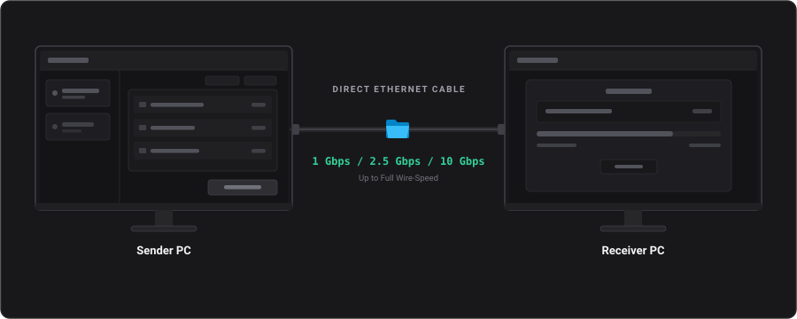

# EtherTransfer 网络架构

> **在线文档**：交互式结构图、性能数据以及指向源码文件的深链，请访问 **[架构与网络文档](https://divyviradiya2.github.io/ethertransfer/docs.html#architecture-networking)**。

## 概述
EtherTransfer 使用 UDP 广播完成对端发现，使用高性能 TCP 流完成文件传输。网络层经过大量加固与重构，以确保在无交换机、无路由器的直连物理以太网上也能绝对可靠地传输。

  

---

## 1. UDP 对端发现（`DiscoveryService.cs`）

EtherTransfer 使用 UDP 端口 **50000** 实现去中心化的设备发现。

### 基于会话的身份标识
设备的身份不绑定静态 IP 地址，而是绑定应用启动时动态生成的 `SessionId`（Guid）。
- **原因**：笔记本在插拔网线时常因 DHCP 或链路本地地址重新协商而更换 IP。若以 IP 作为身份，界面上就会出现"幽灵设备"。
- **机制**：`HELLO` 广播载荷中包含 `SessionId`。界面层与 `DeviceService` 都以该 ID 作为对端的主键；IP 变化时就地更新记录，而不是新建一个重复设备。

### 子网安全过滤
`DiscoveryService` 对收到的 `HELLO` 报文执行严格的企业级过滤。
- 收到报文后，服务会通过 `NetworkHelper.IsIpInActiveSubnets(sourceIpStr)` 交叉校验来源 IP。
- 如果报文来自**未绑定物理以太网卡**的网段（例如从 Wi‑Fi 连接"漏"过来的广播），该报文会被静默丢弃。

---

## 2. 物理链路监控（`EthernetLinkMonitor.cs`）

由于 PC 直连不经过路由器，操作系统常常难以正确分配 IP 地址（会退化为 APIPA/链路本地地址）。`EthernetLinkMonitor` 用一套健壮的实时状态机取代了过去的静态配置脚本。

### 状态机
- **`NoCable`**：未检测到物理以太网链路。
- **`Configuring`**：已检测到物理链路（OperationalStatus 为 UP），但操作系统尚未分配 IPv4 地址。
- **`Ready`**：网卡已 UP 且拥有有效 IPv4 地址，允许进行设备发现与传输。
- **`ConfigError`**：操作系统在超时时间内未能分配 IP 地址。

### Linux 自动配置（`nmcli`）
在 Windows 与 macOS 上，链路本地地址（169.254.x.x）回退机制是原生且可靠的；而在 Linux 上，这个过程经常长时间挂起。
- 当 `EthernetLinkMonitor` 在 Linux 上进入 `Configuring` 状态时，会在后台调用 `nmcli device modify {iface} ipv4.method link-local`，强制网卡进入链路本地模式。
- **还原**：拔掉网线（进入 `NoCable`）或应用退出时，`EthernetLinkMonitor` 会执行 `nmcli device reapply {iface}`，完整恢复用户原有的网络配置，做到"零残留"。

---

## 3. TCP 传输协议与流水线引擎加固

EtherTransfer 直接工作在物理线路上、不经过交换机，因此拔掉网线时操作系统的 TCP 栈并不总能立刻干净地断开连接。为保证持续满速传输且不卡死，做了以下处理：

- **32 MB 流水线通道缓冲**：使用 `System.Threading.Channels` 双缓冲（16 &times; 2 MB 数据块），把 NVMe/SATA 磁盘读取与套接字发送解耦，可完全吸收 NTFS 写入刷盘和杀毒软件实时扫描造成的停顿。
- **套接字缓冲区调优**：将 `SendBufferSize` 与 `ReceiveBufferSize` 设为 2 MB，并启用 `NoDelay = true`，避免 TCP 零窗口停顿与滑动窗口塌陷。
- **原始二进制文件夹流**：采用零分配的长度前缀二进制流 `[4B 路径长度][UTF-8 路径][8B 文件大小][数据]...[4B 0 结束]`，接收端并行落盘（4–16 个并发工作线程），以克服 Windows NTFS 小文件延迟。
- **看门狗超时**：每一个网络 `ReadAsync` / `WriteAsync` 调用都有确定的看门狗保护（元数据 2 秒、数据块 5 秒）。
- **TCP Keep-Alive**：在等待用户确认等空闲状态下，显式启用操作系统原生 TCP Keep-Alive（`SocketOptionName.KeepAlive`），用于检测物理断开。

---

## 4. 结构化诊断

网络层统一使用 `StructuredLogMessage`，所有网络事件都带有结构化标识（`EventId`）与日志级别（`LogLevel`）。
- 这样就把"诊断字符串解析"与"界面渲染逻辑"彻底分开。
- 界面会把日志级别与事件 ID 映射为调试控制台中的不同颜色，开发者可一眼看出 DHCP 失败或看门狗超时。
